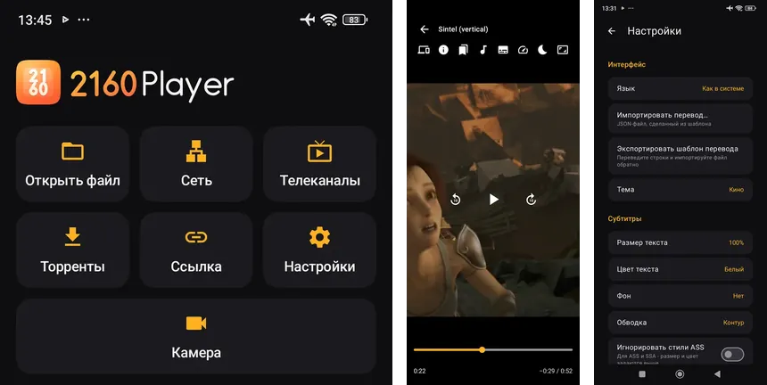
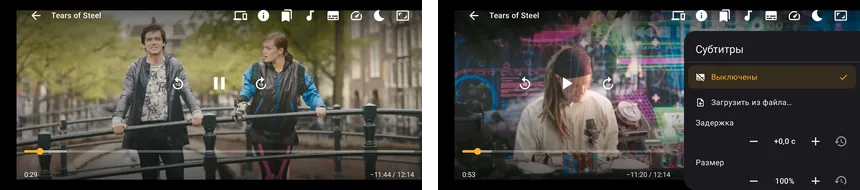
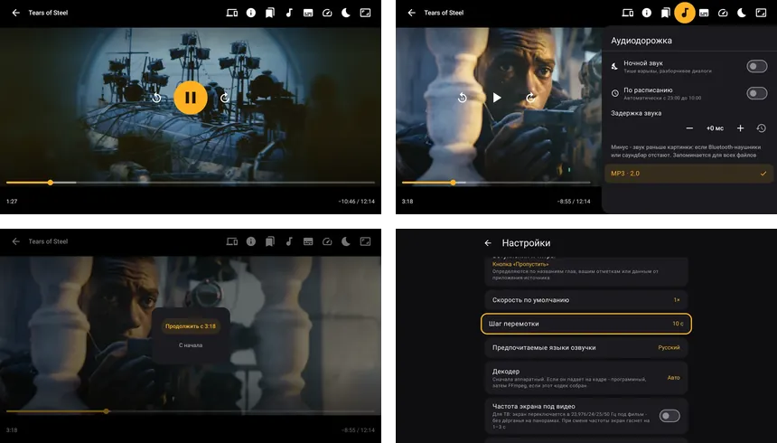
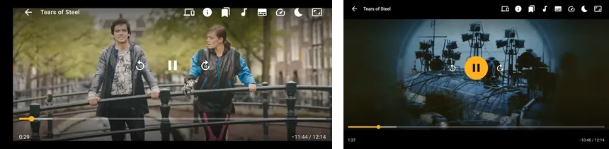

# 2160 Player

Медиаплеер для Android-телефонов и Android TV на Media3 (ExoPlayer) и FFmpeg, интерфейс на Jetpack Compose.
Играет локальные файлы, сетевые потоки, IPTV, папки SMB и DLNA, торренты и образы Blu-ray.
Ядро `player-core` можно встроить в своё приложение или вызвать через Intent из программ, которые уже открывают MX Player или VLC.

[](https://github.com/spacesarmat/2160player/releases/latest)
[](https://github.com/spacesarmat/2160player/releases)
[](LICENSE)
[](docs/wiki/Setup.md)
[](docs/wiki/Setup.md)

*English summary: [below](#english).*

## Скачать

APK берётся из [последнего релиза](https://github.com/spacesarmat/2160player/releases/latest).

| Файл | Кому |
|---|---|
| `arm` | Любой телефон и ТВ на ARM. Этот файл рекомендуется: его же можно отдать другому устройству через «Поделиться приложением». |
| `arm64-v8a`, `armeabi-v7a` | Меньше по размеру, только одна архитектура. |
| `universal` | Если архитектура неизвестна, в том числе x86. |

Дальше приложение обновляется само: Настройки → Обновления.

## Скриншоты

**Телефон (POCO X5)**



Главный экран, плеер вертикально, настройки.



Плеер горизонтально, панель субтитров.

**Android TV (Dune HD 4K Solo)**



Плеер, звук, продолжить просмотр, настройки.

Кадры видео в плеере: Tears of Steel и Sintel, Blender Foundation, CC-BY 3.0 (mango.blender.org, durian.blender.org).

## Возможности

### Форматы и декодеры

- Контейнеры: MKV, MP4, WebM, TS/M2TS, AVI, FLV, OGG, MP3, FLAC и другие.
- FFmpeg там, где устройство не умеет: DTS/DTS-HD, TrueHD, AC-3/E-AC-3, MP3, MPEG-1/2. Passthrough на ресивер.
- Dolby Vision профиля 7 без своего декодера играет базовым слоем HDR10.
- В плеере есть сведения о файле: кодеки, HDR, битрейт.
- Аппаратные декодеры в приоритете. Буфер подбирается по памяти устройства. Звук без видео может идти через аудиочип (offload).
- На ТВ частота экрана подстраивается под видео (23,976/24/25/50 Гц), есть туннельный режим. Статистика поверх видео: декодеры, пропущенные кадры, буфер, сеть, процессор, память.

Подробности AVI, запасного декодера и текстов ошибок: [Форматы и декодеры](docs/wiki/Formats.md).

### Сеть и источники

- HLS, DASH, SmoothStreaming, RTSP и HTTP(S) с заголовками запроса.
- SMB 2/3: сохранённые серверы и обзор папок.
- DLNA/UPnP с автопоиском (Jellyfin, Plex, Kodi, NAS).
- IPTV: плейлисты M3U с группами и логотипами, телегид XMLTV, режим эфира без перемотки. Текущая передача показывается под названием канала.
- Торренты: magnet и `.torrent`, просмотр во время загрузки (libtorrent), выбор файла из раздачи.
- Раздачу можно остановить и продолжить свайпом или кнопкой. Цвет и метка показывают состояние («Качается», «Раздаётся», «Остановлена»), рядом скорость, пиры и прогресс.
- Сеть торрентов: «Везде», «Раздача по Wi-Fi» (по умолчанию), «Только Wi-Fi» с вопросом перед просмотром по мобильному интернету.
- Сколько раздавать: всегда, до 1:1, 24 часа или не раздавать. Можно только на зарядке и ограничить загрузку по мобильной сети.
- Blu-ray: образы `.iso` и папки `BDMV` (файлы, SMB, HTTP). Основной фильм выбирается сам, с диска берутся главы и языки дорожек.
- Дорожки M2TS: TrueHD, LPCM, DTS-HD MA, PGS.

Протокол источников: [Источники](docs/wiki/Sources.md).

### Просмотр

- Субтитры: внешние SRT, ASS, VTT, TTML, своя кодировка, автопоиск рядом с видео (в том числе `content://`: папка запоминается с первого раза), загрузка из файла сразу на экран, задержка, стиль, двойные субтитры.
- Внешняя озвучка: файл рядом с видео (`Movie.ru.mka` и другие, папка `Audio` или `RUS Sound`) в панели звука, ручная загрузка и передача дорожек через Intent. `content://` ищет их так же, как субтитры. Файл, который не открылся, и дорожка без декодера на устройстве не останавливают видео: выбор возвращает предыдущую или встроенную, запомненный неподдерживаемый файл не подставляется снова. Назад на пульте закрывает боковую панель. В разделе «Торренты» озвучка и субтитры берутся из того же торрента, по серии и студии; `Bonus` и `Menu` в плейлист серий не входят. Перемотка и скорость общие со видео.
- Главы и пропуск вступления, пересказа и титров: из глав, из Intent или ручные отметки на весь сериал. Кнопка или автопропуск, карточка «Следующая серия».
- Вступление между сериями можно найти по звуку.
- Продолжение с места, с дорожками, скоростью и задержкой субтитров. Досмотренное в следующий раз открывается с начала.
- Заголовок «Продолжить просмотр» открывает весь список недосмотренного. Обложки берутся из файла, с DLNA или из картинок рядом.
- В конце плейлист переходит к следующему, один файл предлагает посмотреть снова. Эфир это не трогает.
- Ночной звук (сжатие динамики и громкие диалоги) вручную или по расписанию, по умолчанию 23:00-10:00.
- Таймер сна: 15-120 минут или конец серии, с плавным затиханием. Отдельная задержка звука для Bluetooth и саундбаров.
- Плеер запоминает ручной выбор озвучки и субтитров: отдельно для сериала и для набора языков.
- Масштаб: целиком, по ширине, по высоте, заполнить с обрезкой, растянуть. На телефоне - щипок двумя пальцами.

Поведение «Назад», вопрос «Продолжить с …», карточка «Далее» и настройка «По окончании»: [Просмотр](docs/wiki/Playback.md).

### Телефон и ТВ

- Жесты на телефоне, D-pad и пульт, цифровой ввод времени, превью кадров при перемотке, картинка в картинке.
- Свой обзор файлов для Android TV и приставок без системного выбора: внутренняя память, USB, карты памяти, папки Blu-ray и ISO, плейлист папки для «Следующей серии».
- Просмотр можно передать на другой 2160 Player в той же сети Wi-Fi с той же позиции. На исходном устройстве ставится пауза.
- Новое устройство в сети подтверждается один раз: кнопка «Разрешить» или код (на сутки или свой, от 6 цифр). На ТВ по умолчанию «Отклонить», код показан для сверки.
- В фоне: уведомление, экран блокировки, гарнитура и Bluetooth. При сворачивании на выбор: картинка в картинке, звук видео, музыка или пауза.
- Пока идёт видео или эфир, экран не гаснет (Настройки → Воспроизведение, включено по умолчанию). На паузе, в конце и у музыки без картинки может погаснуть.

### Трансляция камеры и экрана

- Телефоны, которые транслируют камеру, видны на главном экране других устройств. Подключение по разрешению или по коду.
- Принимаются `rtsp://`, HLS и `udp://` (MPEG-TS) с низкой задержкой.
- Источник: выбранная камера (задняя, широкоугольная, телевик, фронтальная) или экран, со звуком микрофона и/или телефона.
- Куда отдавать: RTSP на телефоне (OBS, VLC, другой 2160 Player), SRT в OBS, NDI (OBS с DistroAV, vMix), RTMP на YouTube или Twitch.
- Режим до 4K и 60 fps по возможностям камеры и кодировщика. Ориентация как держите телефон. Есть фонарик, фокус касанием и зум.
- Задержка около 0,5 с, у NDI около 0,1 с. Переключатель «Минимальная задержка» укорачивает очереди. Трансляция живёт и со свёрнутым приложением.
- Только Wi-Fi, локальная сеть или точка доступа. Мобильный интернет не используется.
- Пароль RTSP свой на каждую трансляцию и не совпадает с кодом сопряжения. Сопряжённый 2160 Player берёт его сам, VLC и OBS копируют с экрана.

Подробности сервера и списка камер: [Источники](docs/wiki/Sources.md).

### Прочее

- Автообновление из GitHub Releases при запуске (можно выключить): APK под архитектуру устройства, установка в пару нажатий. Если GitHub ограничивает API, проверка читает тег со страницы релиза и пишет, через сколько минут повторить.
- Шесть тем оформления. Языки интерфейса: русский и английский, пакеты JSON, можно импортировать свой перевод.
- Справка и ответы на частые вопросы: Настройки → О приложении. Там же ссылка, куда сообщить об ошибке.
- Приложением можно поделиться без интернета: файлом (Quick Share, Bluetooth, Telegram) или по Wi-Fi с QR-кодом.
- Экран настроек: [Настройки](docs/wiki/Settings.md).

## Ограничения

MPEG-4 ASP (XviD/DivX с B-кадрами и GMC), MS-MPEG4, H.263, WMV и VC-1 пока зависят от декодеров устройства.
В текущей сборке FFmpeg этих декодеров нет, поддержка запланирована. GMC декодер устройства не берёт, даже если сам декодер MPEG-4 есть.
Как плеер выбирает запасной путь и что пишет в ошибке: [Форматы и декодеры](docs/wiki/Formats.md).

## Для разработчиков

### Встраивание

Библиотека в вашем APK или Intent в установленный плеер (`tv.p2160.player`):

```kotlin
// Библиотека в вашем APK
Player2160.play(context, PlaybackRequest.single(Uri.parse("smb://nas/Movies/Film.iso"), "Фильм"))

// Без библиотеки - Intent в установленный 2160 Player
startActivity(
    Intent(Intent.ACTION_VIEW)
        .setDataAndType(Uri.parse("https://example.com/movie.mkv"), "video/*")
        .setPackage("tv.p2160.player")
        .putExtra("title", "Фильм")
)
```

- Быстрый старт: [docs/EMBEDDING.md](docs/EMBEDDING.md) (модуль, `includeBuild`, mavenLocal, GitHub Packages).
- Справочник: [docs/API.md](docs/API.md) (`Player2160`, `PlayerController`, `PlayerScreen`, `PlayerConfig`, Intent).
- Пример хоста: [samples/embed-demo](samples/embed-demo).
- Координата текущей библиотеки: `tv.p2160:player-core:0.2.16`, `minSdk` 24, `compileSdk` 37.
  В приложении-хосте нужны `pickFirsts` для общих `.so` FFmpeg, иначе сборка падает на одинаковых `libavcodec.so`. Пример в [EMBEDDING.md](docs/EMBEDDING.md).

### Сборка

Нужны JDK 21 и Android SDK с платформой 37.

```sh
echo "sdk.dir=/path/to/Android/Sdk" > local.properties   # если файла ещё нет
./gradlew :app:assembleDebug
```

Отладочный APK: `app/build/outputs/apk/debug/`. Release ставится как `tv.p2160.player`, debug - отдельным приложением «2160 Тест».
Команды тестов, публикация AAR и установка через adb: [Сборка и запуск](docs/wiki/Setup.md).
Оглавление остальных страниц: [docs/wiki/Home.md](docs/wiki/Home.md).

### Релиз

Один и тот же ключ подписи нужен, чтобы автообновление поставило новую версию поверх старой.
Тег - `v<versionName>`, `versionCode` каждого релиза больше предыдущего.
На ARM приложение берёт APK с `-arm-` в имени, иначе файл под ABI устройства, иначе `universal`.

<details>
<summary>Ключ и публикация на GitHub</summary>

Ключ и пароли лежат в `keystore.properties` в корне проекта (файл не в git):

```properties
storeFile=/path/to/2160player-release.jks
storePassword=...
keyAlias=2160player
keyPassword=...
```

Те же значения можно задать переменными `P2160_KEYSTORE`, `P2160_KEYSTORE_PASSWORD`, `P2160_KEY_ALIAS`, `P2160_KEY_PASSWORD`.

```sh
# APK под каждую архитектуру + universal
./gradlew :app:assembleRelease -Pp2160.versionName=0.2.0 -Pp2160.versionCode=3
# общий ARM-APK (arm64-v8a + armeabi-v7a): основной файл для скачивания
./gradlew :app:assembleRelease -Pp2160.versionName=0.2.0 -Pp2160.versionCode=3 -Pp2160.abi=arm
gh release create v0.2.0 2160player-0.2.0-*.apk --title "2160 Player 0.2.0" --notes "..."
```

Номера в примере - образец вызова, не текущая версия приложения.

</details>

### Структура проекта

```
player-core/            библиотека плеера (tv.p2160.core)
  api/                  публичный фасад: Player2160, PlaybackRequest, IntentApi, NowPlaying, PlayerAction, SkipSegment
  engine/               PlayerController, сборка ExoPlayer, дорожки, двойные субтитры, отрезки
  ui/                   Compose: PlayerScreen, панели, жесты, темы
  bluray/, m2ts/        чтение ISO/UDF и BDMV, MPLS/CLPI, экстрактор M2TS
  source/               SMB (smbj), DLNA, маршрутизация источников, произвольный доступ
  iptv/                 M3U, XMLTV
  settings/, resume/, i18n/, subtitle/
  src/main/assets/i18n/core/   языковые пакеты ядра
source-torrent/         торренты (libtorrent4j), схема torrent://
app/                    приложение 2160 Player: главный экран, история, сеть, IPTV, торренты,
                        передача между устройствами (handoff/), автообновление (update/), настройки
samples/embed-demo/     пример встраивания библиотеки
design/                 исходники логотипа и баннера
docs/                   документация (API.md, EMBEDDING.md, wiki/)
.github/                CI, шаблоны issue и PR
```

### Участие в разработке

Issue и pull request приветствуются. Шаблоны:
[bug report](.github/ISSUE_TEMPLATE/bug_report.yml),
[feature request](.github/ISSUE_TEMPLATE/feature_request.yml),
[pull request](.github/PULL_REQUEST_TEMPLATE.md).
Перед PR должен проходить `./gradlew assembleDebug testDebugUnitTest lintDebug`.
Изменения публичного API отражайте в [docs/API.md](docs/API.md).
Новые строки интерфейса добавляйте во все языковые пакеты (`assets/i18n/*/en.json`, `ru.json`): это проверяет `TranslationsTest`.

## Автор

Andy_bum - Telegram: [@Andy_bum](https://t.me/Andy_bum). Вопросы, идеи и сообщения об ошибках - в Telegram или в
[Issues](https://github.com/spacesarmat/2160player/issues).

## Поддержать проект

Если плеер пригодился - можно поддержать разработку на [Boosty](https://boosty.to/djmaker/donate).

## Лицензия

[GNU GPL v3.0](LICENSE). Приложение и библиотеку `player-core` можно свободно использовать, изменять
и распространять, в том числе встраивать в свои приложения, - при условии, что производная работа
тоже распространяется под GPL v3 с открытым исходным кодом. Используемые компоненты: Media3
(Apache 2.0), FFmpeg через nextlib (LGPL 3), smbj (Apache 2.0), libtorrent4j (MIT/BSD), RootEncoder и RTSP-Server
(Apache 2.0; RTSP-Server - исходниками с правкой, см. [third-party/rtsp-server/NOTICE.md](third-party/rtsp-server/NOTICE.md)), ZXing (Apache 2.0),
NDI® SDK (заголовки - MIT; библиотека `libndi` - лицензия NDI SDK, в репозиторий не входит; распространение вместе
с ней разрешено дополнительным разрешением [LICENSE-NDI-EXCEPTION.md](LICENSE-NDI-EXCEPTION.md)).
NDI® is a registered trademark of Vizrt NDI AB - https://ndi.video/

---

## English

**2160 Player** is a media player for Android phones and Android TV. The engine is Media3 (ExoPlayer) with FFmpeg decoders, and the UI is Jetpack Compose. The `player-core` module is a library you can embed, or you can send an Intent to the standalone app. Intents line up with what MX Player and VLC already accept. The full screenshot set is in [Скриншоты](#скриншоты).



Phone and Android TV. Video frames are from the Blender Foundation open movies Tears of Steel and Sintel, CC-BY 3.0 (mango.blender.org, durian.blender.org).

### Download

Grab an APK from the [latest release](https://github.com/spacesarmat/2160player/releases/latest).

- `arm` works on any ARM phone or TV and is the file to share with another device. Recommended.
- `arm64-v8a` and `armeabi-v7a` are smaller single-architecture builds.
- `universal` covers the rest, including x86.

The app can update itself from GitHub Releases (Settings, Updates). If the API rate-limits the check, the app reads the latest tag from the releases page and says when to retry.

### What it plays

Local files (the TV build has its own browser for internal storage, USB and SD cards), HTTP, HLS, DASH, SmoothStreaming and RTSP, SMB shares, DLNA servers, IPTV M3U playlists with an XMLTV guide, torrents while they download, and Blu-ray ISO images or BDMV folders (M2TS with TrueHD, LPCM, DTS-HD and PGS).

FFmpeg covers DTS/DTS-HD, TrueHD, AC-3/E-AC-3, MP3 and MPEG-1/2 when the device cannot. Audio can be passed through to a receiver. Dolby Vision profile 7 falls back to the HDR10 base layer when the device has no Dolby Vision decoder.

### Playback

External SRT, ASS, VTT and TTML subtitles, including two on screen at once. An external dub next to the video (or passed in an Intent) joins the audio panel and stays in sync with seek, pause and speed. In the built-in torrent browser, dubs and subtitles from the same torrent are attached per episode and studio. Sidecars next to a `content://` video are picked up too: the folder is asked at most once and then remembered. A file chosen in the player is shown immediately and restored for that video. Chapters, intro/recap/credits skip (from chapters, from an Intent, from marks saved for a whole series, or from audio compared across episodes), and a next-episode card. Resume keeps the position, track choices, speed and subtitle delay. A file watched to the end opens from the start next time. At the end of a playlist the player moves on; a single file offers Watch again and Close. Live TV is left alone.

Night sound can follow a schedule (23:00-10:00 by default). A sleep timer runs 15-120 minutes or until the episode ends. There is a separate audio delay for Bluetooth headphones and soundbars. The player remembers a manual audio and subtitle choice per series and per set of languages in the file.

Hardware decoders come first. The buffer follows device memory (24-128 MB). Audio with no picture can use offload. On TV the refresh rate can follow the video (23.976/24/25/50 Hz), with tunnel mode and a stats overlay. The screen stays on during video and live playback (on by default) and can sleep again on pause, at the end, or for music with no picture.

Back, the resume prompt and the up-next card: [Playback](docs/wiki/Playback.md).

### Phone, TV and camera

Touch gestures, D-pad, numeric time entry, seek thumbnails, picture-in-picture and background audio. Hand-off to another 2160 Player on the same Wi-Fi keeps the position and pauses the source. A new device on the LAN is allowed once, from a notification or a code (a daily code, or your own from 6 digits). On TV the default answer is Reject, and the code is shown so you can check it.

The phone can publish its camera (rear, wide, tele, front) or its screen, with the mic and/or device audio. Targets are RTSP on the phone (OBS, VLC, another 2160 Player), SRT to OBS, NDI (OBS with DistroAV, vMix) and RTMP to YouTube or Twitch. Modes go up to 4K and 60 fps when the camera and encoder allow it. Orientation follows how you hold the phone. Torch, tap to focus and zoom are on the stream screen.

Delay is about 0.5 s, about 0.1 s for NDI. Lowest latency shortens the send queues. Streaming continues in the background. LAN, Wi-Fi or a hotspot only, never mobile data. The RTSP password is per session and is not the pairing code. Other 2160 Players on the LAN show that camera on the home screen. Incoming `rtsp://`, HLS and `udp://` MPEG-TS play with low latency.

### Also

Six themes. Interface languages are Russian and English JSON packs, and you can import your own. Torrent seeding can stay on, stop at 1:1, stop after 24 hours, or stay off, and can be limited to Wi-Fi, to charging, or by a mobile download cap. FAQ and an offline share (a file, or a Wi-Fi QR) are under Settings, About.

### Limitations

MPEG-4 ASP (XviD/DivX with B-frames and GMC), MS-MPEG4, H.263, WMV and VC-1 depend on the device decoder for now. This FFmpeg build does not include them. FFmpeg support is planned. GMC is rejected even when the device has an MPEG-4 decoder. Details: [Formats](docs/wiki/Formats.md).

### For developers

`minSdk` 24, `compileSdk` 37, JDK 21. Build the app with `./gradlew :app:assembleDebug`.

```kotlin
implementation("tv.p2160:player-core:0.2.16")
```

The host must pick the first copy of the shared FFmpeg `.so` files (`libavcodec`, `libavutil`, `libswscale`, `libswresample`). Full steps: [docs/EMBEDDING.md](docs/EMBEDDING.md). Reference: [docs/API.md](docs/API.md). Sample host: [samples/embed-demo](samples/embed-demo). Wiki: [docs/wiki/Home.md](docs/wiki/Home.md).

Call `Player2160.play(context, PlaybackRequest.single(uri))`, or start the installed app (`tv.p2160.player`, debug `tv.p2160.player.debug`, activity `tv.p2160.core.Player2160Activity`) with extras compatible with MX Player (`title`, `position`, `headers`, `subs`, `video_list`, `return_result`) plus `tv.p2160.extra.*`. Results come back in both MX Player and VLC shapes, including `tv.p2160.extra.WATCHED` and a Long position.

`Player2160.config = PlayerConfig(...)` sets the buffer (`PlayerConfig.AUTO` sizes it from device memory, 24-128 MB), network timeouts, and switches for audio intro detection, chapter reading and history. You can watch `Player2160.nowPlaying`, add toolbar buttons with `Player2160.registerAction`, change `PlayerSettings` and read `ResumeStore`.

License: [GPL-3.0](LICENSE). An app that embeds the library has to be GPL-3.0 as well.
Author: Andy_bum, Telegram [@Andy_bum](https://t.me/Andy_bum). Support: [Boosty](https://boosty.to/djmaker/donate).
