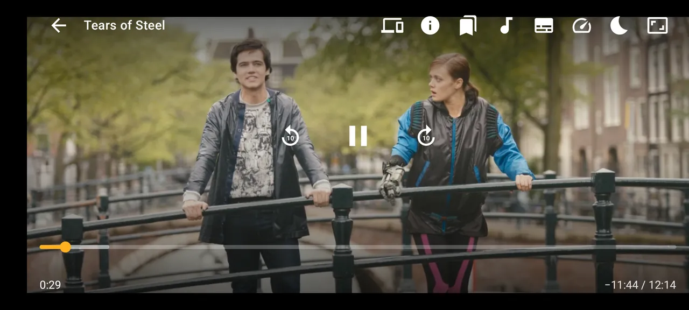
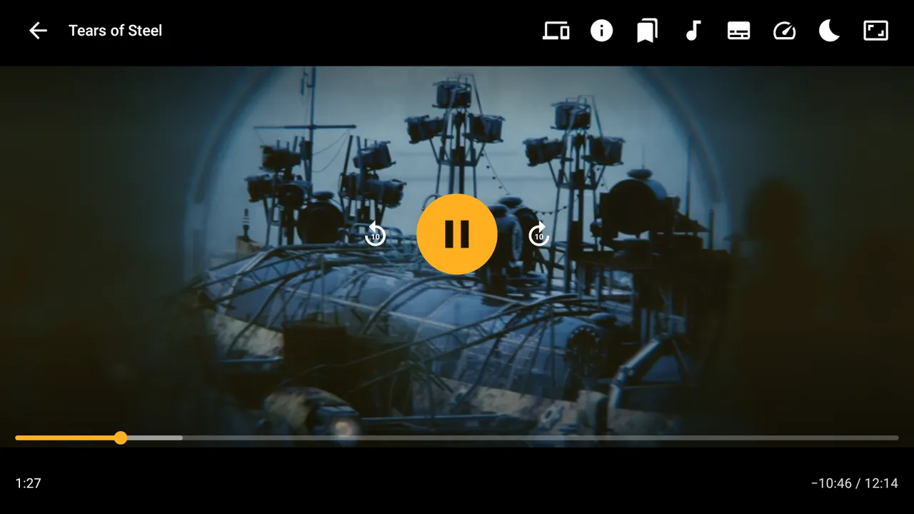

# 2160 Player

Медиаплеер для Android-телефонов и Android TV: Media3 (ExoPlayer), FFmpeg, интерфейс на Jetpack Compose.
Ядро `player-core` встраивается в другие приложения или вызывается через Intent.

Эти страницы готовы для GitHub Wiki: один файл - одна страница. Подробный справочник с примерами кода
остаётся в репозитории: [docs/API.md](../API.md), быстрый старт - [docs/EMBEDDING.md](../EMBEDDING.md).

<p>


</p>

Кадры видео в плеере: Tears of Steel и Sintel, Blender Foundation, CC-BY 3.0 (mango.blender.org, durian.blender.org).

## Страницы

- [Сборка и запуск](Setup.md) - JDK, SDK, Gradle, установка APK, подпись релиза.
- [Архитектура](Architecture.md) - модули, поток воспроизведения, где живёт состояние.
- [Настройки](Settings.md) - экран «Настройки», языки дорожек, ширина на ТВ, «Не выключать экран во время просмотра», «По окончании».
- [Публичный API библиотеки](Library-API.md) - `Player2160`, `PlayerController`, `PlayerScreen`, настройки, история.
- [Intent API](Intent-API.md) - запуск отдельного приложения без библиотеки.
- [HTTP API](Http-API.md) - сервер на устройстве (передача, камера, раздача APK) и GitHub Releases.
- [Источники](Sources.md) - файлы, HTTP, SMB, DLNA, IPTV, торренты, Blu-ray, камера.
- [Форматы и декодеры](Formats.md) - контейнеры, FFmpeg, MPEG-4 и MS-MPEG4, AVI, тексты ошибок.
- [Просмотр](Playback.md) - продолжение, конец файла, Назад, ночной звук в панели.

## Сборка в одну строку

```sh
echo "sdk.dir=$ANDROID_HOME" > local.properties   # JDK 21, Android SDK platform 37
./gradlew :app:assembleDebug :player-core:testDebugUnitTest :app:testDebugUnitTest
```
